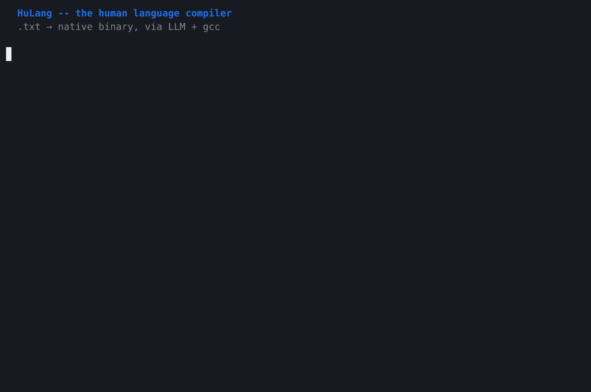
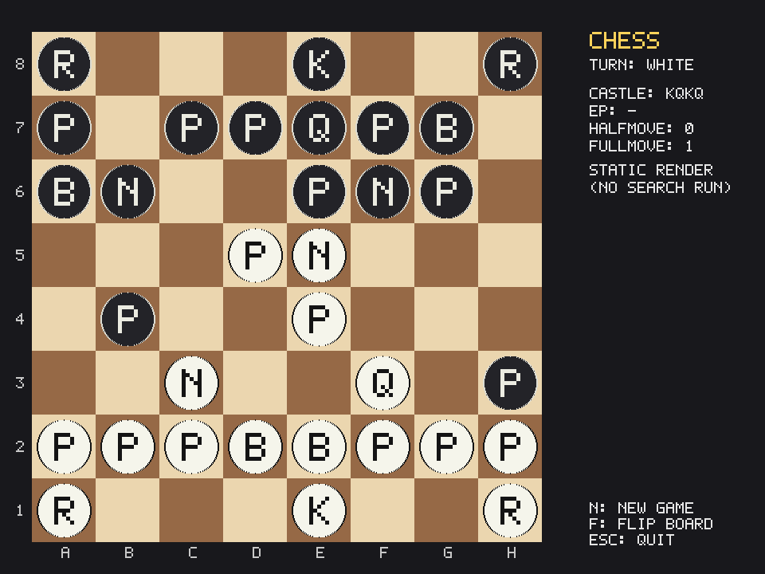
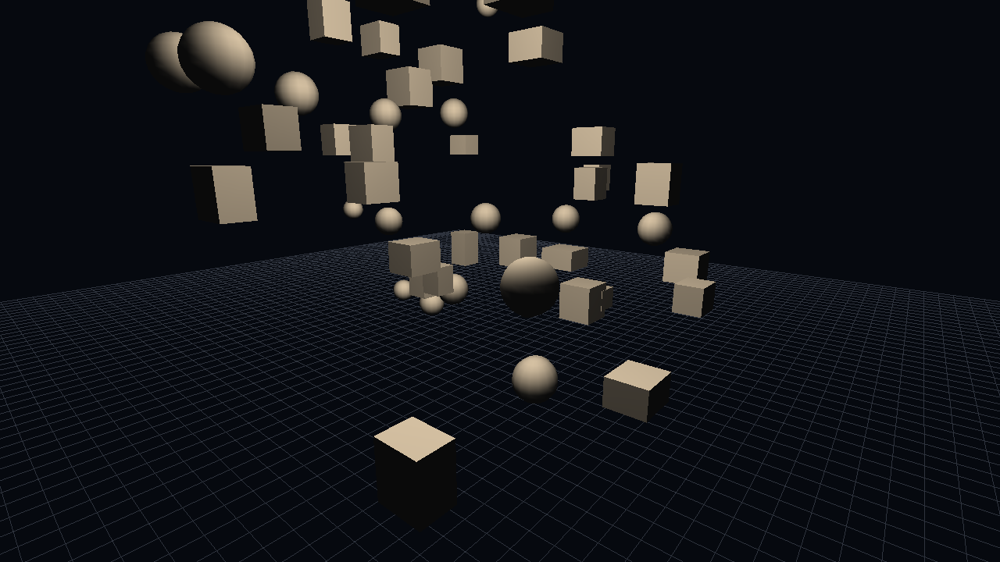
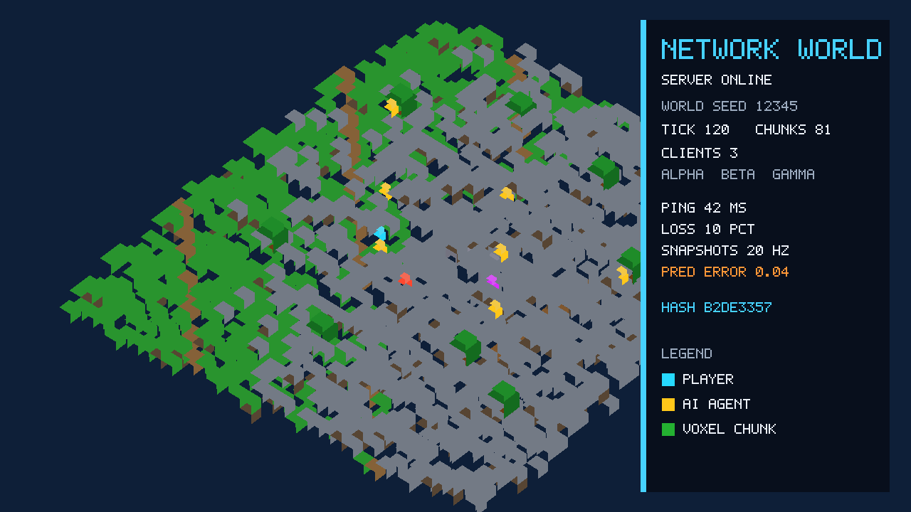
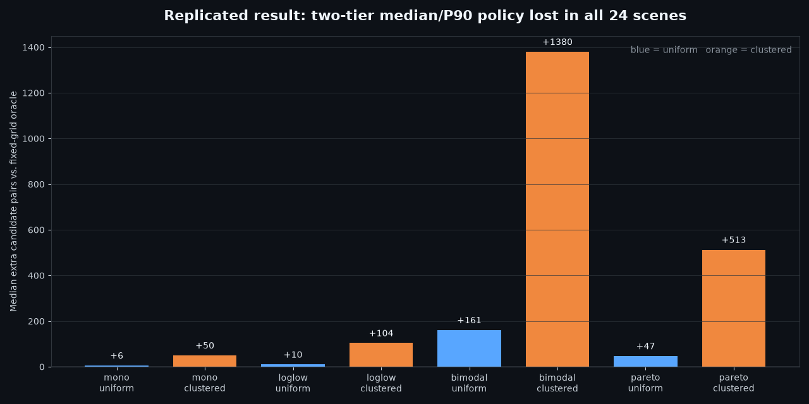

<div align="center">

# HuLang

*The **Hu**man **Lang**uage Compiler*

**Write a `.txt` file in natural language. Compile it to a native binary.**

[](https://codespaces.new/BrendanWalsh/HuLang?quickstart=1)
[](https://pypi.org/project/hulang/)
[](https://github.com/BrendanWalsh/HuLang/actions/workflows/ci.yml)



<sub><em>Live capture: HuLang compiles a human language compiler. That compiler compiles another program. Both are native binaries.</em></sub>

</div>

## Why

Every generation of programmers has looked at the previous generation's tools and
said *"we can do better."* They were right. Every time.


The logical endpoint of all that abstraction is obvious in hindsight: just say what
you want the program to do. HuLang is the final satisfying conclusion to programming
language evolution, and also a text file with a compiler pointed at it.

- **Zero syntax errors.** There is no syntax.
- **Zero learning curve.** You already speak the language.
- **Zero boilerplate.** Unless you want boilerplate, in which case, ask for it.
- **Full type safety.** The types are vibes and the vibes are always valid.

## Quickstart

```sh
curl -fsSL https://raw.githubusercontent.com/BrendanWalsh/HuLang/main/install.sh | bash && export PATH="$HOME/.local/bin:$PATH"
nlc run -c 'Print "Hello, World!" to the screen.'
```

Uses your Copilot CLI login. First time? Run `copilot` and sign in.
See [installation details and CLI reference](REFERENCE.md) for setup and other frontends.

Congratulations. You just compiled human language into machine code.

## Examples

<details>
<summary><b>Number guessing game</b></summary>

[`examples/guessing_game.txt`](examples/guessing_game.txt)

```
Create a number guessing game. The program picks a random number between 1
and 100, then lets the user guess. After each guess, tell them if they're
too high or too low. Count the guesses and when they get it right, tell
them how many tries it took. Ask if they want to play again after each round.
Keep a running scoreboard showing rounds played and average guesses per round.
```

```console
$ nlc run examples/guessing_game.txt
=== Number Guessing Game ===
I'll pick a number between 1 and 100. Try to guess it!

Your guess: 50
Too low! Try higher.
Your guess: 75
Too high! Try lower.
Your guess: 62
Too low! Try higher.
Your guess: 68
Too low! Try higher.
Your guess: 71
Too low! Try higher.
Your guess: 73
Too high! Try lower.
Your guess: 72
Correct! The number was 72.
You got it in 7 guesses!

--- Scoreboard ---
Rounds played : 1
Average guesses: 7.00
------------------

Play again? (y/n): n

Thanks for playing!
Final stats: 1 round, 7.00 guesses/round on average.
```

<details>
<summary><b>The C it wrote</b> — 92 lines, one <code>rand()</code> seeded from <code>time(NULL)</code>, plus a reusable prompt reader</summary>

```c
srand((unsigned int)time(NULL));
...
int secret = (rand() % 100) + 1;
```

The scoreboard requirement produced a `read_int()` helper that reprompts on bad
input, which nothing in the source text asked for by name.

</details>

</details>

<details>
<summary><b>File deduplicator</b></summary>

[`examples/find_duplicates.txt`](examples/find_duplicates.txt)

```
Create a program that takes a directory path as an argument and recursively
finds all duplicate files based on their content (not name). Use MD5 hashing
to compare files. Group the duplicates together and show:
- The hash
- Total wasted space per group
- All file paths in the group
[…]
```

```console
$ nlc build examples/find_duplicates.txt -o dedupe && ./dedupe ./dupedir
Scanning ./dupedir ...
Hash: a97a610117f7a6b880be8f8d3cbc15fa
Wasted space: 4.00 KB
Files (2):
  ./dupedir/a/asset.bin
  ./dupedir/b/asset-copy.bin

Hash: f40771c2d7da59f7483a73069bedf8a8
Wasted space: 104 B
Files (3):
  ./dupedir/a/config.yml
  ./dupedir/b/config.yml
  ./dupedir/c/config-backup.yml

=== Summary ===
Duplicate groups : 2
Total wasted     : 4.10 KB
Files removable  : 3
```

<details>
<summary><b>The C it wrote</b> — 291 lines, with a complete MD5 implementation rather than a link against OpenSSL</summary>

```c
static void md5_transform(uint32_t state[4], const uint8_t block[64]);
static void MD5_Init(MD5_CTX *ctx);
static void MD5_Update(MD5_CTX *ctx, const void *data, size_t len);
static void MD5_Final(uint8_t digest[16], MD5_CTX *ctx);
```

The source text said "use MD5 hashing", not "link against a crypto library", so
the frontend wrote the digest from scratch and the [auto-linker](#compilation-stages)
had nothing to add. Both readings are correct. Only one of them is 291 lines.

</details>

</details>

<details>
<summary><b>Chess engine</b></summary>

[`examples/chess_engine.txt`](examples/chess_engine.txt)

```
Build a complete chess engine as one self-contained native program with a real
2D graphical interface. Use SDL2 through <SDL2/SDL.h>. Do not use an external
chess library, opening-book file, network service, image asset, or font file.
[…]
Generate only legal moves. Support every normal and special rule:

- pawn single and double pushes
- captures and en passant
- promotion to queen, rook, bishop, or knight
- castling on both sides, including all attacked-square restrictions
- check detection and pinned pieces
[…]
Implement an actual chess search:

- iterative deepening
- negamax alpha-beta pruning
- quiescence search over tactical captures and promotions
[…]
The graphical interface must:

- orient the board from the human player's side
- select and move pieces with two mouse clicks
- highlight the selected square and every legal destination
- distinguish captures from quiet legal moves
- highlight the previous move and a king currently in check
[…]
- stay responsive while the engine searches by running search on an SDL thread
  against a copied position, then delivering the result safely to the UI thread
[…]
```



<sub><em>Actual <code>--render-position</code> output from the generated SDL2 binary. The board, pieces, labels, and side panel are drawn in C without external image or font assets.</em></sub>

```console
$ ./chess --perft 4
perft(4) = 197281

$ ./chess --perft 3 \
  "r3k2r/p1ppqpb1/bn2pnp1/3PN3/1p2P3/2N2Q1p/PPPBBPPP/R3K2R w KQkq - 0 1"
perft(3) = 97862

$ ./chess --analyze "7k/5Q2/6K1/8/8/8/8/8 w - - 0 1" --depth 4
depth 4
score mate 1
nodes 1337
bestmove f7e8
pv f7e8
```

Those first two numbers are
[published chess-engine test vectors](https://www.chessprogramming.org/Perft_Results),
not demo fixtures. The generated binary also matched four additional standard
perft positions, then found the forced mate above identically on repeated runs.

<details>
<summary><b>Inside the generated C</b> — shared SDL rendering and background search on top of the verified engine</summary>

```c
typedef struct {
    SDL_atomic_t done;
    SDL_mutex *mutex;
    Board boardCopy;
    int depth;
    SearchInfo result;
} EngineJob;

static int engine_thread_fn(void *data) {
    EngineJob *job = (EngineJob *)data;
    SearchInfo info = search_position(&job->boardCopy, job->depth);
    SDL_LockMutex(job->mutex);
    job->result = info;
    SDL_UnlockMutex(job->mutex);
    SDL_AtomicSet(&job->done, 1);
    return 0;
}

SDL_Surface *surface = SDL_CreateRGBSurfaceWithFormat(0, WIN_W, WIN_H, 32, SDL_PIXELFORMAT_RGBA32);
SDL_Renderer *renderer = SDL_CreateSoftwareRenderer(surface);
[…]
render_position(renderer, &b, &ui);
if (SDL_SaveBMP(surface, outFile) != 0) {
    fprintf(stderr, "Could not save BMP: %s\n", SDL_GetError());
    …
}
```

The generation session produced the complete SDL implementation but timed out
while cleaning repeated append chunks. A mechanical pass removed seven
byte-for-byte duplicate function blocks; no chess or interface logic was
rewritten. The resulting 1,958-line C retained the six standard perft suites,
rendered the screenshot above headlessly, kept a live SDL event loop responsive
during search, and passed AddressSanitizer and UndefinedBehaviorSanitizer.

</details>

</details>

<details>
<summary><b>3D physics sandbox</b></summary>

[`examples/physics_sandbox.txt`](examples/physics_sandbox.txt)

```
Build a self-contained native 3D physics sandbox using SDL2 and desktop OpenGL.
Include <SDL2/SDL.h> and <GL/gl.h>. Do not load models, textures, shaders, fonts,
or configuration files at runtime.
[…]
Implement:

- gravity and semi-implicit Euler integration
- deterministic seeded scene generation
- a spatial-hash broad phase rather than testing every body pair
- sphere/sphere, sphere/box, and box/box contact generation
- iterative impulse resolution with restitution, friction, and positional
  correction
[…]
```



<sub><em>Actual seeded <code>--render-snapshot</code> output. Geometry, lighting, physics, camera, and BMP encoding all live in the generated C.</em></sub>

```console
$ ./physics --benchmark --seed 42 --bodies 128 --steps 240
seed=42 bodies=128 steps=240 broadphase_candidates=0 narrowphase_contacts=17 sleeping_bodies=18 kinetic_energy=5933.58904 state_hash=3eb15134e7818c5f
```

The same command produced the same 64-bit state hash on repeated runs. The
benchmark and renderer also completed under AddressSanitizer and
UndefinedBehaviorSanitizer.

<details>
<summary><b>Inside the generated C</b> — spatial hashing feeding a fixed-step impulse solver</summary>

```c
static void build_broadphase(World *world) {
    int i;
    hash_clear(&world->hash);
    for (i = 0; i < world->body_count; ++i) {
        Body *body = &world->bodies[i];
        float r = body_bound(body) + 0.3f;
        […]
        for (x = minx; x <= maxx; ++x)
            for (y = miny; y <= maxy; ++y)
                for (z = minz; z <= maxz; ++z)
                    hash_insert(&world->hash, i, x, y, z);
    }
}

static void physics_step(World *world) {
    integrate(world);
    build_broadphase(world);
    generate_contacts(world);
    […]
}
```

The model emitted 821 lines. A three-line validation repair corrected the
snapshot camera, selected an early deterministic frame, and removed a double
vertical flip in the OpenGL-to-BMP path; the simulation logic was unchanged.

</details>

</details>

<details>
<summary><b>Networked procedural world</b></summary>

[`examples/networked_world.txt`](examples/networked_world.txt)

```
Build one self-contained native program that can run as an authoritative server,
a graphical client, or a headless bot for a small networked procedural 3D world.
Use SDL2, desktop OpenGL, POSIX sockets, and pthreads. Include <SDL2/SDL.h> and
<GL/gl.h>. Do not require external assets, a database, or persistent world files.
[…]
The world is regenerated from a numeric seed on every run. Generate chunked voxel
terrain with hills, caves, colored materials, and a few deterministic moving AI
agents. The protocol only needs to connect processes running this same binary
version.
[…]
mouse input. Implement client-side prediction for the local player, interpolation
for remote entities, reconciliation against authoritative snapshots, chunk
request/caching, and visible network statistics: ping, sequence, prediction error,
snapshot rate, loaded chunks, and simulated loss.
[…]
```



<sub><em>Actual seeded render from the same binary that ran the server and bots. The bitmap HUD, voxel scene, players, structures, and network state are all drawn in generated C. No world file survives the run.</em></sub>

```console
$ ./world --protocol-self-test
joins=3 movements=3 chunk_requests=3 delayed=1 reordered=1 disconnects=1 reconnects=1 malformed=0 state_hash=efb5420c94ce7280
protocol_self_test=pass

$ cat server.log
server port=29124 seed=4242
join name=beta id=1
join name=alpha id=2
join name=gamma id=3
leave id=1
leave id=2
leave id=3
snapshots=12 dropped=0 world_hash=8ebde742cb4eabc6

$ cat alpha.log
final_position=unknown last_authoritative_tick=4 received_snapshots=4 world_hash=5eb3d6d1cc73cb3c
$ cat beta.log
final_position=unknown last_authoritative_tick=4 received_snapshots=4 world_hash=5eb3d6d1cc73cb3c
$ cat gamma.log
final_position=unknown last_authoritative_tick=4 received_snapshots=4 world_hash=5eb3d6d1cc73cb3c
```

Those bot hashes came from three separate processes connected to the real server
socket. The protocol self-test and renderer also passed under ASan/UBSan.

<details>
<summary><b>Inside the generated C</b> — authoritative snapshots and deterministic divergence checks</summary>

```c
static void send_snapshot(World *world, Player *recipient)
{
    SnapshotPacket packet;
    […]
    packet.sequence = ++recipient->sequence;
    packet.tick = world->tick;
    packet.world_hash = world_hash(world);
    […]
    send_all(recipient->fd, &packet, sizeof(packet));
}

update_agents(&world);
update_agents(&copy);
second_hash = world_hash(&world);
if (second_hash != world_hash(&copy)) {
    fprintf(stderr, "protocol_self_test=fail\n");
    return 1;
}
```

The initial 975-line model output needed one compile/validation pass for four C
errors and the self-test comparison. Strengthening the generated snapshot scene,
adding its embedded bitmap HUD, and preserving the verified protocol brought the
validated source to 1,187 lines.

</details>

</details>

<details>
<summary><b>Agentic auto-researcher</b></summary>

[`examples/auto_researcher.txt`](examples/auto_researcher.txt)

```
Build a native command-line auto-researcher that uses GitHub Copilot CLI as its
runtime agentic engine. Given a research prompt, it must perform real literature
and web research, generate and test hypotheses, run reproducible local
experiments, challenge its own conclusions, track citations, and write a complete
research paper.
[…]
Coordinate these explicit research phases:

1. Planner: decompose the prompt into answerable questions, novelty criteria,
   source-quality rules, and falsifiable hypotheses.
2. Literature mapper: search primary sources first, collect prior art, and build
   a citation/claim graph.
3. Hypothesis generator: propose mechanisms or algorithms that differ from the
   located prior art and predict measurable outcomes.
4. Experimenter: write and run bounded scripts/programs inside the workspace,
   record exact commands, environment, seeds, raw output, and hashes.
[…]
7. Replicator: rerun the strongest experiments from clean commands and compare
   hashes/tolerances.
8. Paper writer: synthesize only claims supported by the evidence ledger.
[…]
```



<sub><em>Result generated by a real nine-phase run: six primary sources, ten hypotheses, 24 scenes, two clean replications, an independent third rerun, and a cited paper.</em></sub>

```console
$ ./researcher status --workspace /tmp/hulang-research-run --budget 9
workspace: /tmp/hulang-research-run
phases completed: 9/9
calls used: 9
calls remaining: 0
sources: 6
hypotheses: 10
experiments: 10
verification: /tmp/hulang-research-run/verification.json
paper: /tmp/hulang-research-run/paper.md
notebook: /tmp/hulang-research-run/lab-notebook.md

$ ./researcher verify --workspace /tmp/hulang-research-run && cat /tmp/hulang-research-run/verification.json
{
  "status": "passed",
  "failures": 0,
  "sources": 6,
  "hypotheses": 10,
  "experiments": 10,
  "calls": 9
}
```

The run investigated an adaptive two-tier spatial hash. It mapped prior work,
generated falsifiable hypotheses, wrote and executed a 265-row experiment,
replicated it, audited novelty, and produced a bounded negative result:

> In the bounded experiment and its clean replication, the two-tier policy
> emitted more unique candidate pairs than the fixed-grid oracle in all 24
> scenes: paired differences ranged from +4 to +1413, with no tie or reduction.

[Read the generated paper](examples/auto_researcher_output/paper.md), inspect the
[evidence ledger](examples/auto_researcher_output/evidence.jsonl), or rerun the
[preserved experiment](examples/auto_researcher_output/reproduce.sh).

<details>
<summary><b>Inside the generated C</b> — bounded agent phases plus native citation verification</summary>

```c
child = fork();
if (child == 0) {
    chdir(workspace);
    dup2(output_fd, STDOUT_FILENO);
    dup2(error_fd, STDERR_FILENO);
    execvp(arguments[0], arguments);
    _exit(errno == ENOENT ? 127 : 126);
}

arguments[0] = "copilot";
arguments[1] = "-p";
arguments[2] = (char *)prompt;
arguments[3] = "--model";
arguments[4] = (char *)model;
arguments[5] = "--allow-all-tools";

curl_easy_setopt(curl, CURLOPT_URL, url);
curl_easy_setopt(curl, CURLOPT_FOLLOWLOCATION, 1L);
curl_easy_setopt(curl, CURLOPT_TIMEOUT, 10L);
```

The initial 524-line orchestrator compiled but its verifier was too shallow. A
bounded repair pass added libcurl URL checks, citation-ID enforcement, strict
call accounting, artifact validation, and safe path handling; validation fixes
for the generated citation schema brought the final source to 914 lines. The
binary, verifier, and status paths pass ASan/UBSan.

</details>

</details>

See [`examples/`](examples/) for more: Fibonacci, a word-frequency
counter, an expression calculator, Game of Life, a maze generator, a todo app,
a raytracer, an HTTP server, a terminal text editor, and the human language compiler
from the demo.

## How it works

Not interpreted. Not transpiled. Compiled. HuLang is a real compiler with a real
pipeline — it just happens to have an LLM where most compilers have a parser.


## FAQ

**Is this a joke?**
Yes, but it compiles, it runs, and it produces real native binaries. Try it yourself.

**Is this production-ready?**
Absolutely not. But neither was C in 1972.

**How do I debug my program?**
Read the generated C with [`nlc emit`](REFERENCE.md#inspecting-the-intermediate-c). If the
behavior is wrong, change the `.txt` source and recompile.

**What if compilation fails?**
Rephrase the source program and build again.

**Can I write programs in any human language?**
Yes, and probably some inhuman language as well! YMMV.

## Contributing

Contributions welcome. See [CONTRIBUTING.md](CONTRIBUTING.md).

## License

[MIT](LICENSE) — because the language of the people should be free.
